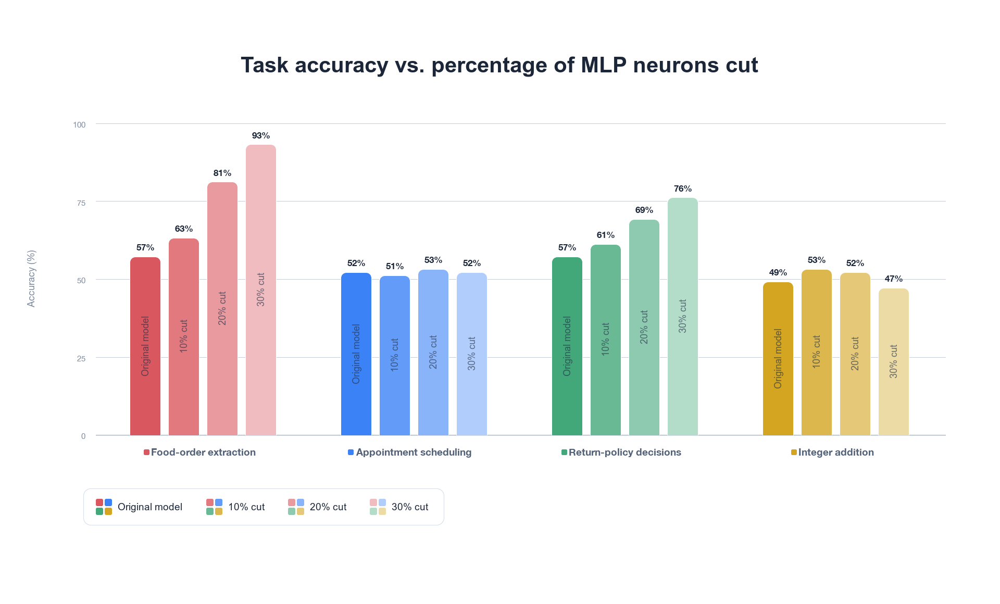

# Task-specific MLP pruning on Gemma 2 2B

This project’s goal is to find how many MLP channels can be removed for a task while keeping its accuracy. The Python / PyTorch pipeline ranks neurons by activation × downward sensitivity on a training set, then jointly learns which combination of neurons to keep across all 26 MLP layers for a chosen cut size. It removes the rest and checks performance on a separate testing set.

[Interactive results](https://oliveramaher.github.io/task-specific-mlp-pruning/)

# Process

https://github.com/user-attachments/assets/8cc2cf20-38d2-4f8a-88d3-99aea350fe3e

### 1. Measure how much each neuron affects training loss

For each training example, feed Gemma the prompt and its correct answer. Then compute mean cross-entropy on the answer tokens, and backpropagate to the MLP activations immediately before each layer’s down projection. A **neuron’s activation** tells us its output strength. Its **gradient** tells us how sensitive the loss is to that activation. Multiply them, sum across tokens, square, and average across the training examples:

$$
F_j = \frac{1}{2M}\sum_{i=1}^{M}\left(\sum_t a_{itj}\frac{\partial L_i}{\partial a_{itj}}\right)^2
$$

Here, $a_{itj}$ is neuron $j$’s activation at token $t$, $L_i$ is the training answer loss, and $M=50$. This is a **diagonal empirical Fisher approximation for neuron gates**: an initial estimate of loss sensitivity rather than a count of how often a neuron fires. A low score makes a neuron a candidate for removal; it does not prove that the neuron is unused. The next stage learns which combination of neurons to keep.

Implementation: [`src/fisher.py`](src/fisher.py).

### 2. Create the starting mask

Flatten the scores across all 26 layers and select the lowest-scoring channels for removal. A 20% cut removes **47,923 of 239,616 MLP channels** globally. Individual layers lose different proportions.

Fisher supplies the initial selection. During the forward pass, binary gates use **1 to keep a channel and 0 to remove its contribution**. The saved `removed` arrays use `True` for channels to delete.

### 3. Learn a better selection at the same budget

For a 20% cut, the optimizer can change **which** 47,923 neurons are removed, but it must always remove 47,923. It learns this selection from the training answers.

Give every channel a trainable gate score, initialized in Fisher-ranking order. On each forward pass, keep the highest-scoring channels and mask the rest. After backpropagation, update the scores and select the mask again, but **original model weights are always frozen**.

The forward gates are binary. A **straight-through estimator** supplies sigmoid gradients during backpropagation, including for masked channels. That lets the optimizer restore initially removed neurons and remove different ones while keeping the total removal count fixed.

Implementation: [`src/masks.py`](src/masks.py).

### 4. Slice the matrices, then test the smaller model

For each mask, load the original weights and physically slice the MLP matrices: remove the selected rows from the gate and up projections, and the matching columns from the down projection. The surviving weights keep their original values; attention, embeddings, and the output head stay unchanged. Each cut level starts from the original weights and its own mask.

Run the resulting smaller model on the same 100 held-out prompts per task using greedy decoding, then grade its answers. Food orders are compared as food/quantity pairs regardless of item order; appointment and policy outputs are checked for matching JSON fields, values, and types; addition must exactly match the expected integer. These grading rules are used only for evaluation, not mask training.

Implementation: [`src/model.py`](src/model.py), [`src/generation.py`](src/generation.py), and [`src/evaluation.py`](src/evaluation.py).

# Results



The chart shows exact-match accuracy on 100 held-out examples per task, comparing the original model with masks that remove 10%, 20%, or 30% of MLP channels. Accuracy varies by task: food-order extraction and return-policy decisions score highest at a 30% cut, appointment scheduling stays nearly flat, and integer addition is highest at a 10% cut. These are results on these four test sets; they do not establish that pruning improves performance in general.

# Run

Use Python 3.13 to match the saved experiments. Accept the [Gemma model license](https://huggingface.co/google/gemma-2-2b) and sign in to Hugging Face before downloading its weights.

```bash
python3.13 -m venv .venv
source .venv/bin/activate
pip install -r requirements.txt
hf auth login
```

Check the saved masks and all 1,600 responses without loading the model:

```bash
python verify.py
python -m unittest discover -s tests
```

Evaluate the saved food-order masks, or recompute Fisher scores and learn new masks from its 50 training examples:

```bash
python run.py --tasks food --cuts 0 10 20 30
python run.py --tasks food --cuts 10 20 30 --fit --output runs/refit
```

The other task names are `appointments`, `returns`, and `addition`. Omitting `--tasks` runs all four. Generated files go into `runs/`; packaged masks and results stay in `masks/` and `results/`.

# Results website

The React / TypeScript site displays the saved masks and responses; browsing it requires no model or Python server. Use Node.js 22.12 or newer:

```bash
cd visualization
npm ci
npm run dev
```

`npm run build` produces the static site in `visualization/dist/`. To regenerate the site's cached data from this repository's datasets, masks, and results, run `python visualization/export.py` from the repository root with NumPy installed.

For GitHub Pages, select **Settings → Pages → Source → GitHub Actions**. The included [workflow](.github/workflows/pages.yml) builds and publishes the site on pushes to `main`, or when run manually. The site will be available at `https://oliveramaher.github.io/task-specific-mlp-pruning/` after deployment.
